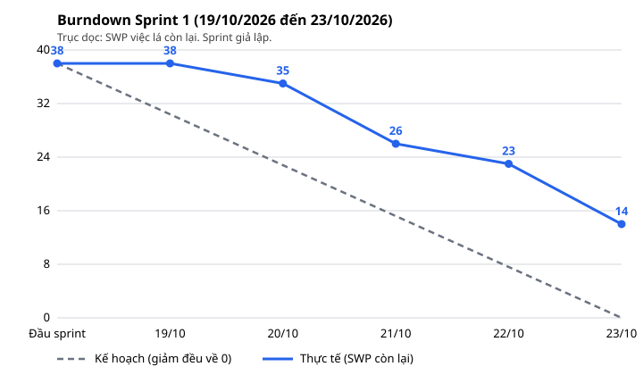

# Báo cáo tiến độ · Iteration: Sprint 1 · 19/10/2026–23/10/2026 (giả lập)

Kính gửi ban quản lý chợ. Báo cáo này tổng kết Sprint 1 (5 ngày làm việc) của dự án hệ thống hỗ trợ vận hành chợ. Số liệu đọc trực tiếp từ GitHub Project của dự án (https://github.com/users/hoangndn-1456/projects/3).

Đây là sprint **giả lập** cho bài LAB-5: trạng thái và ngày xong do kịch bản đặt, không phải đội thật đã làm. Ghi chú gốc của kịch bản: "Giả lập; SWP chốt sau ngày bắt đầu sprint. Trạng thái và Ngày xong là giả lập, ngày đóng thật trên GitHub có thể khác."

**Tóm tắt:**
- Cam kết: 12 item (10 việc lá, 2 story), 38 SWP, 138,5 giờ ước lượng.
- Hoàn thành: 6 việc, 24 SWP (63,2% SWP cam kết).
- Còn lại 14 SWP chưa đóng, ở ba trạng thái: QA Testing (1 việc), In Review (1 việc) và In Progress (2 việc, trong đó một việc chờ phản hồi của quý khách, R1, và một việc chờ hai việc chưa vào sprint, R4). Tất cả đưa vào kế hoạch Sprint 2 (26/10/2026–30/10/2026). Màn chốt giao dịch thỏa thuận (SCR030) và danh sách giao dịch (SCR032) **chưa thể demo** trong Sprint 1.
- Ba màn SCR012, SCR013, SCR014 **không kịp hoàn thành** trong Sprint 2, vì chuỗi việc phải làm nối tiếp dài hơn một sprint (R3).
- Cần khách hỗ trợ ngay: trả lời câu hỏi về thời điểm "chốt" giao dịch và quy tắc ưu tiên căn cứ (rủi ro R1, R2), hạn sáng 26/10/2026.

## 1. Trạng thái

Đếm trên việc lá của sprint; trạng thái story suy từ việc con. Các trạng thái theo quy trình của dự án, từ trước ra sau: In Progress (đang làm), In Review (review chéo), QA Testing (kiểm thử), Closed (đã đóng).

| Trạng thái | Số issue | Tổng SWP | Ghi chú |
|---|---|---|---|
| Closed | 6 | 24 | 87,5 giờ ước lượng. Issue: #6, #7, #13, #22, #189, #190 |
| QA Testing | 1 | 3 | 11 giờ ước lượng. Issue: #8 |
| In Review | 1 | 3 | 11 giờ ước lượng. Issue: #193 |
| In Progress | 2 | 8 | 29 giờ ước lượng. Issue: #24, #188 |
| **Tổng** | 10 | 38 | 138,5 giờ ước lượng |

### Từng ticket trong sprint

Trạng thái cuối sprint của mỗi ticket cam kết, story đứng trước các việc con. Ngày xong chỉ có ở ticket đã đóng.

| Ticket | Việc | Loại | Vai | SWP | Trạng thái cuối sprint | Ngày xong | Ghi chú |
|---|---|---|---|---|---|---|---|
| #2 | SCR030 · Chốt giao dịch thỏa thuận | Story | BrSE | 38 | In Progress | — | Suy từ con: còn con chưa Closed hoặc chưa cam kết |
| #6 | SCR030 · Tính ngày nghiệp vụ đang mở không giới hạn 50 lô | Dev Task | BE-2 | 3 | Closed | 22/10 | — |
| #7 | SCR030 · RPC tạo giao dịch một transaction, khóa ngày | Dev Task | BE-1 | 6 | Closed | 23/10 | — |
| #8 | SCR030 · Migration: CHECK đơn giá và chỗ lưu 参加上限 | Dev Task | BE-2 | 3 | QA Testing | — | Migration CHECK đơn giá xong code, đang chạy test DB; phần kiểm 参加上限 chờ khách trả lời SCR030-Q7 và đã có việc riêng (#146) |
| #13 | SCR030 · Thiết kế ca kiểm thử chốt giao dịch | Test Design | QA-1 | 4 | Closed | 21/10 | — |
| #4 | SCR032 · Danh sách giao dịch và chuyển trạng thái | Story | BrSE | 25 | In Progress | — | Suy từ con: còn con chưa Closed hoặc chưa cam kết |
| #22 | SCR032 · FE khung giải thích FIG-012 và nút chuyển trạng thái | Dev Task | FE-1 | 5 | Closed | 21/10 | — |
| #24 | SCR032 · Test chuyển trạng thái, lỗi 409, mất mạng và tự làm mới | Test Design | QA-1 | 5 | In Progress | — | Thiết kế ca test làm được trước; phần ca cần mã giao dịch chờ #20 (chưa vào sprint) |
| #188 | BR-PERM-01 · Làm rõ với khách: thời điểm chốt, căn cứ bắt buộc theo loại | Dev Task | BrSE | 3 | In Progress | — | Câu hỏi gửi khách 21/10; DoD cần câu trả lời của khách, đang chờ phản hồi |
| #189 | BR-PERM-01 · Bộ kiểm 許可 còn hiệu lực cho bên loại 仲卸 (ACT-02) | Dev Task | BE-1 | 3 | Closed | 20/10 | Bộ kiểm một loại căn cứ không phụ thuộc thời điểm chốt (R1) hay quy tắc ưu tiên căn cứ (R2); khách trả lời khác thì mở issue mới, không mở lại issue này |
| #190 | BR-PERM-01 · Màn SCR012 quản lý riêng căn cứ 許可 | Dev Task | FE-1 | 3 | Closed | 23/10 | — |
| #193 | BR-PERM-01 · Bộ kiểm 承認 còn hiệu lực cho bên 売買参加者 (ACT-03) | Dev Task | BE-2 | 3 | In Review | — | Bộ kiểm 承認 xong code, đang review chéo; ca biên valid_to chờ người review xác nhận |

Mọi việc cam kết ở lại Iteration Sprint 1 làm bản ghi sprint đã chạy. Việc chưa cam kết vẫn ở backlog, chưa gán Iteration; Sprint 2 lập kế hoạch ngày 26/10/2026.

## 2. Burndown

SWP của việc lá còn lại cuối mỗi ngày làm việc, tính theo field `Ngày xong (giả lập)`. Kế hoạch giảm đều về 0 ở ngày làm việc cuối.

Số liệu của biểu đồ:

| Ngày | Kế hoạch (SWP còn lại) | Thực tế (SWP còn lại) | Việc đóng trong ngày |
|---|---|---|---|
| Đầu sprint | 38 | 38 | — |
| 19/10 | 30,4 | 38 | — |
| 20/10 | 22,8 | 35 | #189 |
| 21/10 | 15,2 | 26 | #13, #22 |
| 22/10 | 7,6 | 23 | #6 |
| 23/10 | 0 | 14 | #7, #190 |

**Thực tế lệch kế hoạch ở đâu:**
- **Cam kết theo năng lực.** Đội cam kết 127,5 giờ trên năng lực 140 giờ (91%; 4 người × 7 giờ × 5 ngày, giờ theo baseline không AIDD). Ngoài ra có một việc của BrSE (hỏi khách), không tính vào năng lực đội. Mỗi người nhận không quá năng lực của mình; việc vượt năng lực hoặc còn chờ khách để lại backlog.
- **Việc đã đóng:** API tạo giao dịch, kiểm ngày nghiệp vụ, hai màn FE (khung giải thích chuyển trạng thái và màn quản lý căn cứ 許可), thiết kế test chốt giao dịch và bộ kiểm 許可. Bộ kiểm 許可 làm theo cách đọc hiện hành của các câu hỏi còn mở (R1, R2); quý khách trả lời khác thì chúng tôi mở việc mới để sửa. Việc đã đóng dùng 87,5 giờ.
- **Sát đích nhưng chưa đóng:** migration giới hạn đơn giá đang chạy test cơ sở dữ liệu (phần giới hạn 参加上限 chờ quý khách trả lời, đã có việc riêng); bộ kiểm 承認 đã xong code, đang review chéo. Hai việc này có thể đóng ngay đầu Sprint 2 nếu qua kiểm thử và review.
- **Chậm hơn kế hoạch từ ngày đầu.** Ngày đầu chưa đóng việc nào vì các việc đầu tiên dài hơn một ngày công; cuối sprint còn 14 SWP, trong khi kế hoạch là 0. Hai việc còn ở mức đầu (thiết kế test và câu hỏi gửi khách) đã biết phải chờ ngay từ lúc lập kế hoạch (R1, R4), không phải do ước lượng sai; hai việc còn lại chỉ cần thêm kiểm thử và review.

## 3. Rủi ro trễ

| Rủi ro | Issue | Ảnh hưởng tới mốc nào | Hành động | Ai làm, khi nào |
|---|---|---|---|---|
| **R1.** Khách chưa trả lời SCR032-Q6 và SCR030-Q17 (chữ "chốt" là tạo nháp hay đạt 確定): ràng buộc đặc thù BR-PERM-01 và phần quyết định của #11; câu hỏi gửi 21/10, chưa có phản hồi | #188, #186, #11 | Nếu khách chọn tạo nháp (A): gỡ #186 và thu hẹp TECH-BE-TRANSITION. Nếu chọn đạt 確定 (B): xếp #186 và #11 vào Sprint 2. Khách trả lời sau 26/10 thì #11 và #186 không vào được Sprint 2, SCR030 và SCR032 không đóng được trước 30/10 | Nhắc khách trả lời, đính kèm hai cách đọc A và B bằng ví dụ; hạn trả lời sáng 26/10; nếu khách im thì giữ cách đọc B, ghi vào PREMISE và báo khách bằng văn bản. Khách trả lời khác cách đọc đã dùng cho #189 (đã đóng) thì mở issue mới để sửa; với #193 (đang review) thì sửa tại chỗ | BrSE nhắc khách 23/10; hạn khách trả lời 26/10 09:00 |
| **R2.** Khách chưa chốt quy tắc ưu tiên căn cứ khi một bên có nhiều căn cứ còn hiệu lực (SCR030-Q8, SCR030-Q15): ràng buộc đặc thù BR-PERM-01, #182 chưa bắt đầu | #182, #188 | #182 (bộ lọc bên mua B-4) không đóng được trước khi có câu trả lời; màn chốt giao dịch SCR030 thiếu một bộ lọc khi demo cuối Sprint 2, 30/10 | Gộp vào lần nhắc ở R1; đề xuất sẵn quy tắc ưu tiên "căn cứ có hiệu lực dài nhất" để khách chỉ cần gật hoặc sửa. Khách chọn quy tắc khác thì mở issue mới cho bộ kiểm đã đóng (#189) và sửa tại chỗ #193 đang review | BrSE gửi đề xuất cùng lần nhắc ở R1; thời điểm làm #182 chốt ở buổi lập kế hoạch Sprint 2 ngày 26/10 |
| **R3.** Chuỗi phụ thuộc chưa xếp sprint: #185 → E02-FUNC014 (#53) → #203 → #204 → #205 nối tiếp; thêm E02-FUNC013 và E05-TECH-BE-TRANSITION (#25, còn chờ #186 và E17-RB-KHOA-NGUYENTU). Ba story SCR012, SCR013, SCR014 chưa bắt đầu; riêng phần quản lý căn cứ 許可 trên màn SCR012 (#190) đã xong như một việc ràng buộc | #185, #203, #204, #205, #206, #209, #9 | Riêng chuỗi SCR012 nối tiếp 69 giờ, khoảng 9,9 ngày làm việc; SCR012–SCR014 không đóng được trong Sprint 2 (30/10) | Đề xuất thứ tự: #185, FUNC014, FUNC013, TECH-BE-TRANSITION trước, theo chuỗi phụ thuộc; ngày hoàn thành SCR012–SCR014 gửi khách sau buổi lập kế hoạch Sprint 2 | SDM và BrSE chốt thứ tự ở buổi lập kế hoạch Sprint 2 ngày 26/10 |
| **R4.** Thiết kế test SCR032 (#24) còn dở: phần ca test cần mã giao dịch chờ #20, và #20 chờ #174; cả hai chưa vào sprint vì BE-1 đã đủ việc. Cam kết #24 là có chủ ý: kế hoạch ngày 19/10 đã biết #20 chưa vào sprint, QA-1 làm trước các ca không cần mã giao dịch | #24, #20, #174 | #24 chỉ đóng được sau #174 và #20, sớm nhất cuối Sprint 2 (30/10); màn danh sách giao dịch SCR032 chưa demo được nếu hai việc này không xếp đầu Sprint 2 | Đề xuất xếp #174 rồi #20 lên đầu Sprint 2 cho BE-1; QA-1 hoàn thiện #24 ngay khi #20 qua review | SDM và BrSE chốt ở buổi lập kế hoạch Sprint 2 ngày 26/10; ngày dự báo gửi khách sau buổi đó |
| **R5.** Chuỗi SCR030 còn lại nối tiếp #10 → #12 → #14; chạy test chốt giao dịch (#14) còn chờ #11, mà #11 chờ khách trả lời (R1). QA-1 đã đóng thiết kế test (#13) | #10, #12, #14, #11, #24, #23 | Chuỗi 40 giờ nối tiếp, khoảng 5,7 ngày làm việc, vượt Sprint 2 (5 ngày, hạn 30/10); chạy test chốt giao dịch (#14) có nguy cơ lùi sang Sprint 3 | Đề xuất thứ tự #10 → #12 → #14, xếp #11 ngay khi khách trả lời R1; báo khách ngày chạy test dự kiến | SDM và BrSE chốt ở buổi lập kế hoạch Sprint 2 ngày 26/10; ngày chạy test gửi khách sau buổi đó |

Ngày dự báo cho từng màn sẽ gửi quý khách sau buổi lập kế hoạch Sprint 2 ngày 26/10/2026; trước buổi đó chúng tôi chưa cam kết ngày demo.
